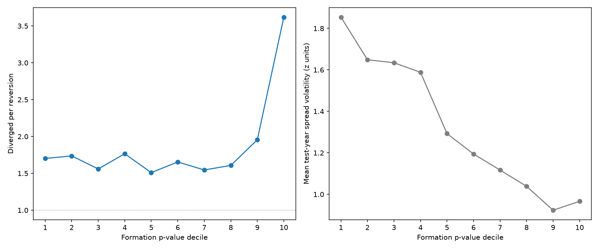
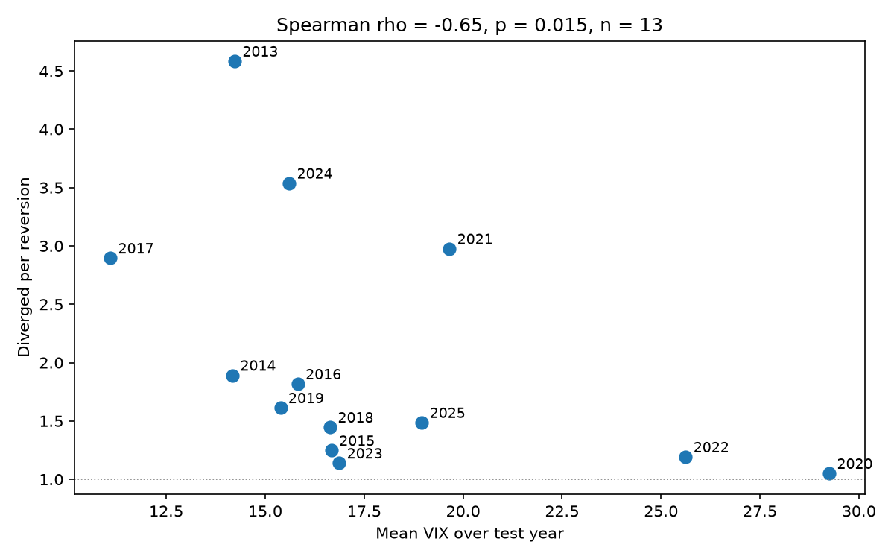

# Does the cointegration p-value pick pairs that revert?

Pairs are usually selected with an Engle-Granger test, with a smaller p-value
taken to mean a better pair. This study tests that out of sample.

## Data

- 54 S&P 500 stocks: top 8 by market cap in each of the 7 largest GICS sectors
  (GOOG excluded as a second share class of GOOGL, GEV for short history)
- 13 rolling windows: 3 year formation, 1 year test (test years 2013-2025)
- Both directions of each pair are screened (2,862 ordered pairs per window).
  36,578 of a possible 37,206 ordered pair-years clear the 650 day minimum,
  the shortfall falling on ABBV, META and TSLA in the early formation windows.
  The outcome analysis keeps one direction per pair: 18,289 pair-years
- Alpha, beta and spread std are fitted on formation and held fixed in the test
  year

## Outcome

In the test year, a spread opens the first time |z| reaches 2. It is then:

- **reverted** if z crosses zero
- **diverged** if |z| reaches 4 first
- **unresolved** if neither happens by year end

The measure is diverged per reversion. Overall: 16,481 opened, 8,061 diverged,
4,535 reverted, 3,885 unresolved, a ratio of 1.78.

## Results

### 1. The screen's pass rate is within noise

A block bootstrap resamples returns with the same blocks for every stock, which
removes cointegration but keeps cross-sectional correlation and volatility
clustering. On the 2015-17 formation window, the same length as the windows it
is compared against (20 replications each):

| Block length | Mean pass rate | sd | 5th-95th percentile |
|---|---|---|---|
| 10 days | 7.15% | 3.54pp | 2.9%-13.9% |
| 21 days | 6.16% | 4.01pp | 1.9%-12.0% |

Observed pass rates at p < 0.05 range from 3.54% to 13.07%. All are inside the
block 10 range, but 2025 is above the block 21 95th percentile, and at 20
replications those percentiles are approximate.

The spread of the null is the point. Under independence a 7% pass rate over
2,862 tests would have a standard deviation near 0.5pp. The measured 3.5-4.0pp
corresponds to roughly 36-52 independent tests, so 2,862 pairs drawn from 54
stocks carry far less information than the count suggests.

### 2. The p-value does not rank pairs below decile 9

Deciles are formed within each test year.



| Decile | Mean p | Opened | Diverged | Reverted | Ratio |
|---|---|---|---|---|---|
| 1 | 0.043 | 1,800 | 1,023 | 601 | 1.70 |
| 2 | 0.137 | 1,728 | 943 | 543 | 1.74 |
| 3 | 0.236 | 1,683 | 858 | 550 | 1.56 |
| 4 | 0.331 | 1,669 | 853 | 483 | 1.77 |
| 5 | 0.435 | 1,640 | 749 | 496 | 1.51 |
| 6 | 0.536 | 1,605 | 733 | 443 | 1.65 |
| 7 | 0.645 | 1,534 | 654 | 423 | 1.55 |
| 8 | 0.756 | 1,542 | 635 | 395 | 1.61 |
| 9 | 0.866 | 1,549 | 661 | 338 | 1.96 |
| 10 | 0.962 | 1,731 | 952 | 263 | 3.62 |

The ratio has no ordering across deciles 1-8.

### 3. The p-value tracks spread volatility

| Decile | Open rate | Resolved share | Mean spread vol |
|---|---|---|---|
| 1 | 97.9% | 90.2% | 1.85 |
| 5 | 89.7% | 75.9% | 1.29 |
| 8 | 84.3% | 66.8% | 1.04 |
| 10 | 94.6% | 70.2% | 0.97 |

Spread vol is the standard deviation of the test year z-score. Pair-level
Spearman correlation with the p-value: -0.41.

A small p-value comes from a tight formation fit, so a small `spread_std`. As
the denominator of z, that makes out-of-sample moves larger in z units. Low
p-value pairs therefore open and resolve more often, in both directions, which
is why the counts change across deciles and the ratio does not.

### 4. The ratio is higher in low volatility years



| Against mean VIX (n = 13 years) | Spearman rho | p |
|---|---|---|
| Diverged per reversion | -0.654 | 0.015 |
| Mean spread vol | +0.203 | 0.505 |

Spread vol does not move with VIX, so this is not the result in 3 at the yearly
level. Year-by-year figures are in `notes.md`.

The relationship holds in rank terms with one exception. 2021 had the third
highest mean VIX in the sample at 19.66 and still gave 2.98 divergences per
reversion.

### 5. Economic linkage does not separate either

| | Opened | Diverged | Reverted | Resolved share | Ratio |
|---|---|---|---|---|---|
| Same sector | 2,108 | 1,009 | 577 | 75.2% | 1.75 |
| Cross sector | 14,373 | 7,052 | 3,958 | 76.6% | 1.78 |

Two stocks in the same GICS sector share a factor the formation regression is
fitting, so their spread has a reason to come back that an arbitrary pair does
not. It does not show up in the outcome: 1.75 against 1.78, on 2,108
same-sector pair-years. Neither the p-value nor sector membership ranks pairs
in this universe.

## Validation

`test_coint.py` checks the engine against data where the answer is known by
construction. On cointegrated series it recovers a hedge ratio of 2.0 to within
0.4% across 49 seeds, recovers the half life, and detects every true pair. On
1,000 independent random walks the false positive rate is 5.5% and the p-values
are approximately uniform.

Tolerances come from the measured spread rather than from guessing. Nothing
downstream is trusted until these pass.

`labels.py` run directly checks the outcome classifier on seven hand-worked
z-paths: a reversion from each side, a position unresolved at year end, a
divergence, a spread that never opens, a second opening that must be ignored,
and a day that crosses zero and lands beyond the barrier.

## Running it

```bash
pip install -r requirements.txt

python universe.py      # stock universe
python prices.py        # adjusted closes
python test_coint.py    # engine validation, ~20 min
python screen.py        # screen, ~30 min
python bootstrap.py     # null distribution, ~1 hr
python labels.py        # outcome per pair-year
python analysis.py      # tables and figures
```

## Limitations

- Survivorship bias: current index members and caps are used back to 2010
- The VIX result rests on 13 years
- No standard errors on the decile table, since pair-years share stocks and years
- The null is estimated on one window with 20 replications
- Barrier levels (2 and 4) and formation length (3 years) are not varied
- The opening day is not checked for divergence, so a spread that opens beyond
  4 sd has one more day to come back
- A spread already beyond 2 sd on the first day of the test year opens
  immediately, on a dislocation that began during formation
- Prices end on 30 December 2025